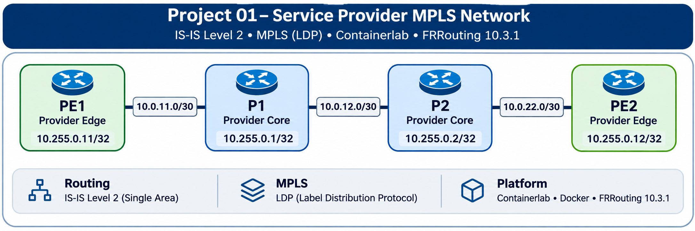

# Project 01 — Service Provider MPLS Network

**Four-router service provider transport lab | Containerlab · Docker · FRRouting 10.3.1**

This hands-on lab builds and validates a service provider MPLS transport network. It demonstrates **IS-IS Level 2 routing**, **LDP label distribution**, Linux MPLS forwarding, packet-level troubleshooting, and successful forwarding verification after redeployment.

## Network Architecture

This project implements a four-router service provider MPLS transport network using Containerlab and FRRouting.



```

*Logical topology: PE1 → P1 → P2 → PE2. Addresses inside router nodes are /32 loopbacks; link labels identify /30 transport subnets.*

### Router Addressing

| Router | Role | Loopback (/32) | Transport interface(s) |
|---|---|---|---|
| PE1 | Provider edge | `10.255.0.11` | eth1: `10.0.11.2/30` |
| P1 | Provider core | `10.255.0.1` | eth2: `10.0.11.1/30`; eth1: `10.0.12.1/30` |
| P2 | Provider core | `10.255.0.2` | eth1: `10.0.12.2/30`; eth2: `10.0.22.1/30` |
| PE2 | Provider edge | `10.255.0.12` | eth1: `10.0.22.2/30` |

### Routing and Transport

| Component | Implementation |
|---|---|
| Interior routing | IS-IS Level 2 (`CORE`) |
| Label distribution | MPLS LDP |
| MPLS forwarding | Linux kernel MPLS routes and label operations |
| Routing software | FRRouting 10.3.1 |
| Lab orchestration | Containerlab and Docker |
| Packet inspection | tcpdump (Wireshark-compatible PCAP) |

## Implementation

The project was built and validated in the following sequence:

1. Create the four-node Containerlab topology.
2. Configure transport interfaces and loopback addresses.
3. Enable IS-IS Level 2 and verify adjacencies and routes.
4. Enable Linux MPLS forwarding and configure LDP.
5. Verify LDP sessions, label tables, and kernel MPLS forwarding entries.
6. Test connectivity between provider-edge loopbacks in both directions.
7. Capture MPLS-encapsulated ICMP traffic.
8. Redeploy the lab and repeat control-plane and data-plane verification.

## Verification Results

| Test | Observed result | Status |
|---|---|---|
| IS-IS Level 2 adjacencies | Neighbors established | PASS |
| LDP sessions | Operational neighbors | PASS |
| MPLS forwarding | Label tables and Linux kernel entries populated | PASS |
| PE1 ↔ PE2 connectivity | Successful bidirectional verification | PASS |
| MPLS encapsulation | EtherType `0x8847`; label `19` observed | PASS |
| Packet capture | 15 MPLS packets captured in validation | PASS |
| Connectivity loss | 0% loss in successful validation | PASS |
| Post-redeployment test | MPLS-encapsulated forwarding verified again | PASS |

## Evidence

- [IS-IS neighbor and route evidence](evidence/isis/)
- [Final MPLS verification](evidence/mpls/final-verification/)
- [MPLS packet captures](evidence/mpls/packet-capture/)
- [Post-redeployment verification](evidence/mpls/post-redeployment/)
- [Post-redeployment verification summary](evidence/mpls/post-redeployment/Verification-Summary.md)

The PCAP files can be opened in Wireshark or decoded with `tcpdump`.

## Rebuild Documentation

The step-by-step reference material includes prerequisites, topology, addressing, FRRouting configuration, verification, troubleshooting, and complete rebuild commands.

| Step | Guide |
|---|---|
| 01 | [Prerequisites](documentation/build-guide/01-Prerequisites.md) |
| 02 | [Containerlab topology](documentation/build-guide/02-Containerlab-Topology.yml) |
| 03 | [IP addressing](documentation/build-guide/03-IP-Addressing.md) |
| 04 | [FRRouting configuration](documentation/build-guide/04-FRRouting-Configuration.md) |
| 05 | [MPLS verification](documentation/build-guide/05-MPLS-Verification.md) |
| 06 | [Troubleshooting and recovery](documentation/build-guide/06-Troubleshooting-Recovery.md) |
| 07 | [Complete rebuild command reference](documentation/build-guide/07-Rebuild-Command-Reference.md) |

Additional project references: [Router configuration snapshots](documentation/configuration-reference/) · [Network topology file](topology/service-provider.clab.yml) · [Software versions](documentation/references/Installed-Software-Versions.txt)

> **Rebuild note:** The Containerlab topology includes host-specific bind-mount paths. Update those paths to match the target Linux machine before deploying the lab.

## Project Status

**Completed:** Four-router MPLS core, control-plane and data-plane verification, packet captures, and post-redeployment forwarding validation.

**Potential next steps:** Customer-edge routing, BGP, MPLS L3VPN services, and failover testing.
