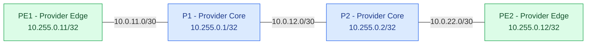

# Project 01 - Service Provider Network

## Overview

This project implements a service provider routing
environment using Containerlab, Docker, and FRRouting.

The lab demonstrates IS-IS routing, MPLS forwarding,
LDP label distribution, and packet-level verification.

## Network Architecture

This project implements a four-router service provider
MPLS transport network using Containerlab and FRRouting.

### Routing and Transport

- **IGP:** IS-IS Level 2
- **MPLS:** Label Distribution Protocol (LDP)
- **Routing Platform:** FRRouting 10.3.1
- **Container Platform:** Containerlab and Docker
- **Topology:** PE1 → P1 → P2 → PE2

### Verified Results

- IS-IS neighbor adjacencies established
- LDP neighbor sessions operational
- MPLS forwarding labels installed
- End-to-end PE connectivity verified
- MPLS-encapsulated ICMP traffic captured
- Forwarding verified after redeployment

## Technologies

- Containerlab
- Docker
- FRRouting 10.3.1
- IS-IS Level 2
- MPLS
- LDP
- Linux MPLS forwarding
- tcpdump

## Implementation

1. Create the Containerlab topology.
2. Configure router interfaces and loopbacks.
3. Configure IS-IS Level 2 routing.
4. Verify routing adjacencies and route installation.
5. Enable Linux MPLS forwarding.
6. Configure MPLS LDP.
7. Verify LDP neighbor relationships.
8. Inspect MPLS forwarding and label tables.
9. Test end-to-end PE connectivity.
10. Capture MPLS-encapsulated traffic.
11. Redeploy the lab and verify persistence.

## Verification Results

### Control Plane

- IS-IS adjacencies operational
- LDP sessions established
- MPLS labels distributed
- Routing information exchanged

### Data Plane

- PE1 to PE2 connectivity verified
- PE2 to PE1 connectivity verified
- MPLS EtherType 0x8847 observed
- MPLS label 19 observed in packet captures
- 15 MPLS packets captured during validation
- 0% packet loss during successful verification

## Evidence

Verification artifacts are stored under:

- evidence/isis/
- evidence/mpls/final-verification/
- evidence/mpls/packet-capture/
- evidence/mpls/post-redeployment/

Packet captures can be inspected using Wireshark
or tcpdump.

## Rebuild Documentation

Detailed implementation and troubleshooting procedures
will be maintained in the documentation directory.

## Project Status

MPLS core implementation and post-redeployment
forwarding verification completed successfully.

Future expansion may include customer-edge routing,
BGP, MPLS L3VPN services, and failover testing.
