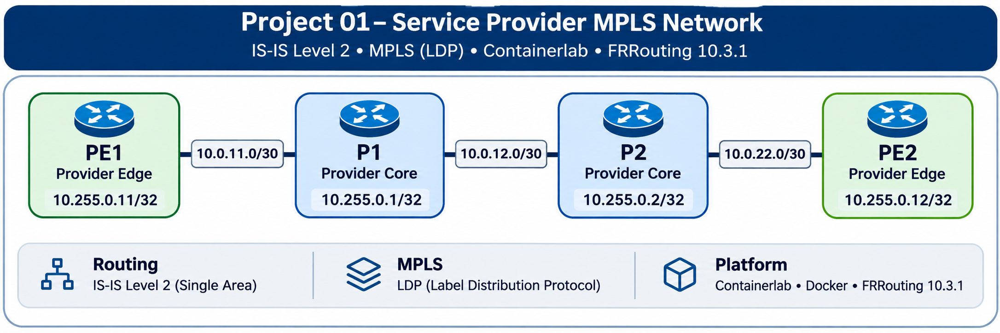

# Network Engineering Portfolio

### Service Provider Networking | Enterprise Infrastructure | Routing & Switching | Network Automation

Welcome to my hands-on Network Engineering Portfolio.

I am an experienced Network and Telecommunications Engineering professional with a background in enterprise infrastructure, service operations, network design, troubleshooting, and technical leadership.

This repository demonstrates practical engineering skills through reproducible network labs, architecture documentation, protocol verification, MPLS forwarding, recovery procedures, and operational troubleshooting.

---

## Featured Project

### Project 01 — Service Provider MPLS L3VPN

**Status:** Six-router recovery validation completed — November 11, 2026.

**[Explore Project 01 — Architecture, Configurations, and Test Results](Project-01-Service-Provider-Network/)**

### Project Overview

Designed and validated a six-router service-provider network using Ubuntu Linux, Containerlab, Docker, and FRRouting.

The environment combines a four-router MPLS provider backbone with two customer-edge routers to demonstrate end-to-end Layer 3 VPN connectivity.

**Network topology:** CE1 → PE1 → P1 → P2 → PE2 → CE2

### Technologies and Protocols

| Category | Technologies |
|---|---|
| Network simulation | Containerlab, Docker |
| Routing software | FRRouting (FRR) |
| Provider routing | IS-IS Level 2 |
| MPLS transport | MPLS, LDP |
| VPN services | MP-BGP VPNv4, CUSTOMER-A L3VPN |
| Operating system | Ubuntu Linux |
| Verification | Linux routing tables, FRR commands, ICMP testing, packet analysis |

### Verified Engineering Results

- Established IS-IS routing and MPLS/LDP transport across the provider backbone.
- Verified MP-BGP VPNv4 sessions between PE1 and PE2, with one VPN prefix advertised and received by each PE.
- Implemented CUSTOMER-A VRF using Linux routing table 1001.
- Confirmed MPLS-encapsulated remote customer routes on both provider-edge routers.
- Validated bidirectional communication between CE1 and CE2 using explicit customer loopback source addresses.
- Documented recovery procedures, troubleshooting findings, and network validation evidence.
- Preserved separate original, persistence, and isolated recovery test environments.

### Final Connectivity Results

| Test | Result |
|---|---|
| CE1 → CE2 | 5/5 received, 0% packet loss |
| CE2 → CE1 | 5/5 received, 0% packet loss |
| MP-BGP VPNv4 | Established on both provider-edge routers |
| CUSTOMER-A VRF | Operational on PE1 and PE2 |
| Recovery validation | PASS |

*The results reflect the recorded validation environment. A non-blocking route-distinguisher discrepancy remains documented, and future reboot persistence has not been conclusively established.*

### Project Documentation

| Resource | Description |
|---|---|
| [Project Overview](Project-01-Service-Provider-Network/) | Architecture, design, and implementation summary |
| [Architecture and Addressing](Project-01-Service-Provider-Network/documentation/ARCHITECTURE.md) | Router roles, addressing, and protocol design |
| [Recovery Runbook](Project-01-Service-Provider-Network/documentation/RECOVERY-RUNBOOK.md) | Recovery procedures and verification commands |
| [Troubleshooting Findings](Project-01-Service-Provider-Network/documentation/TROUBLESHOOTING.md) | Technical issues, resolutions, and open observations |
| [Completion Report](Project-01-Service-Provider-Network/documentation/COMPLETION-REPORT.md) | Recorded validation results |
| [Evidence Inventory](Project-01-Service-Provider-Network/evidence/README.md) | Evidence descriptions and verification references |

---

## Engineering Capabilities Demonstrated

**Network Architecture:** Service-provider backbone design, enterprise routing concepts, network segmentation, and Layer 3 VPN design.

**Routing and Forwarding:** IS-IS, BGP, MPLS, LDP, VPNv4 route exchange, Linux VRF routing, and forwarding verification.

**Operations and Troubleshooting:** Protocol diagnostics, connectivity validation, infrastructure recovery, configuration analysis, and technical documentation.

**Infrastructure Platforms:** Linux, Containerlab, Docker, and FRRouting.

---

## Repository Objectives

- Demonstrate practical network engineering and infrastructure operations capabilities.
- Build repeatable environments for learning and validation.
- Document network architecture, routing configurations, and protocol behavior.
- Validate network connectivity through measurable results.
- Develop reusable troubleshooting and recovery procedures.
- Maintain technical evidence suitable for engineering review.

---

## Related Engineering Portfolios

- [Cloud Infrastructure & Automation](https://github.com/jr6793108/Multi-Cloud-Lab)
- [Cybersecurity & Identity Management](https://github.com/jr6793108/Cybersecurity)
- [Professional Engineering Profile](https://github.com/jr6793108)

---

*Engineering through practical implementation, technical verification, troubleshooting, and continuous improvement.*